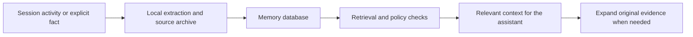

<p align="center">
  
</p>

# IronMem

**Persistent, source-backed memory for AI coding assistants.**

IronMem helps developers carry project decisions, fixes, and useful context between
coding sessions. It stores memory in a database you control, retrieves relevant
evidence, and lets an assistant expand a summary back to its original source.
One Rust executable provides a CLI, MCP server, REST API, and local workbench.

[](https://github.com/BMC-INC/Iron-mem/actions/workflows/rust.yml)
[](LICENSE)

[Install](#install) · [Connect an assistant](#mcp-setup) · [Reference](docs/reference.md) · [Evaluation](#benchmarks) · [Privacy](PRIVACY.md)

## What it does

| Capability | Why it matters |
| --- | --- |
| Project and user memory | Keep project decisions separate from preferences that apply across projects. |
| Keyword, vector, and graph retrieval | Find useful context without copying an entire conversation into each prompt. Vector search depends on the configured embedder. |
| Exact source recovery | Inspect the original transcript or tool evidence behind a compressed memory. |
| Governed retrieval | Apply provenance, namespace, consent, classification, and influence controls before returning memory. |
| Snapshots and recovery | Export recoverable project checkpoints and retain verified database backups during upgrades. |
| Shared client interfaces | Use the same store from CLI, MCP clients, REST integrations, and the local workbench. |

Local session extraction needs no model API key. Claude Code hooks can capture
supported session activity automatically; other clients use MCP tools or their
own integration. The separate [Cursor plugin](https://github.com/BMC-INC/ironmem-cursor-plugin)
provides guided recall and explicit, user-requested saving.

## Project status

The source reports version **0.4.0**. Install from source using the instructions
below; a version in `Cargo.toml` is not a promise of a published binary release.
See [releases](https://github.com/BMC-INC/Iron-mem/releases) and
[release procedure](RELEASING.md) for packaged builds.

The default path uses SQLite and local extraction. PostgreSQL and external vector
or graph backends have additional setup and validation requirements. Structured
temporal assertions, working-set selection, chunked writes, and idle synthesis
are opt-in. See the [capability reference](docs/reference.md#current-v040-capabilities)
and [storage methodology](docs/benchmarks/memory-density/README.md).

Memory can be incomplete or wrong. Source evidence and policy controls help a
caller evaluate it; they do not establish model accuracy, regulatory compliance,
or immunity to prompt injection.

## Install

Source builds require **Rust/Cargo, Python 3.9+, and Git**.

### macOS and Linux

```sh
git clone https://github.com/BMC-INC/Iron-mem.git
cd Iron-mem
./install.sh --no-hooks
export PATH="$HOME/.ironmem/bin:$PATH"
ironmem --version
```

This installs the runtime and writes an MCP configuration with its absolute
executable path. To also register Claude Code lifecycle hooks, omit `--no-hooks`.
Add the printed PATH line to your shell configuration if you want it to persist.

### Windows PowerShell

```powershell
git clone https://github.com/BMC-INC/Iron-mem.git
cd Iron-mem
powershell -ExecutionPolicy Bypass -File install.ps1
& "$env:USERPROFILE\.ironmem\bin\ironmem.exe" --version
```

Windows integrations use MCP. Follow the installer's printed instructions to add
the executable directory to your user PATH.

For upgrades, stop existing IronMem processes and keep the verified backup the
installer creates. External databases need their own backup. See
[installation and recovery](docs/installation-and-recovery.md).

## CLI

From a project directory, save and retrieve a harmless project decision:

```sh
ironmem status
ironmem remember "This project uses SQLite for its local cache." --kind architecture
ironmem search "local cache"
```

Expected result: the saved decision appears in the search results. These commands
use the configured memory store. For a disposable evaluation, follow
[isolate a trial](docs/installation-and-recovery.md#isolate-a-trial).

Use `ironmem --help` for commands and `ironmem COMMAND --help` for options.
The [CLI reference](docs/reference.md#cli) covers diagnostics, snapshots,
extraction recovery, policy controls, and source inspection.

## MCP Setup

The installer creates `~/.ironmem/mcp.json` with an absolute executable path and
explicit settings file. Merge its IronMem entry into your client's MCP settings,
preserving other configured servers. GUI apps may not inherit your shell PATH.

| Client | Setup |
| --- | --- |
| Cursor | [Dedicated plugin and local installer](https://github.com/BMC-INC/ironmem-cursor-plugin) or [manual MCP setup](docs/reference.md#cursor-mcp-setup) |
| Claude Code | [MCP and optional lifecycle hooks](docs/reference.md#claude-code-mcp-setup) |
| Claude Desktop | [Stdio MCP configuration](docs/reference.md#claude-desktop-mcp-setup) |
| Codex | [MCP configuration](docs/reference.md#codex-mcp-setup) |
| Other clients | [Transport and client guide](docs/reference.md#mcp-setup) |

After connecting, call `get_status`, save a synthetic project fact with
`remember`, and retrieve it with `search_memories`. Client support depends on its
MCP configuration and policies. A successful standalone protocol check does not
prove that every client UI has loaded the server.

## How it works



The default database is `~/.ironmem/mem.db`. Settings live in
`~/.ironmem/settings.json`. Context injection can write `IRONMEM.md` into a
project. Keep databases, generated memory context, credentials, and private
transcripts out of public commits.

Local extraction is the default, but it is not a global network switch. Optional
cloud enrichment, explicit profile refresh, reranking, synthesis, remote
backends, and your assistant's model calls have separate data flows. Read the
[privacy guide](PRIVACY.md) before enabling them.

## Benchmarks

IronMem publishes the harnesses and evidence needed to examine its claims:

- **LoCoMo:** a recorded run achieved **72.4%** on 1,540 scored questions using
  Gemini 2.5 Pro as answerer and judge, hybrid retrieval, and the documented
  synthesis and normalized-hint supplements. It excluded 446 adversarial
  questions from the headline. [Artifacts, configuration, and limitations](https://github.com/BMC-INC/ironmem-locomo-benchmark).
- **Reliability:** [recorded recovery, installation, and scale checks](docs/benchmarks/reliability/VALIDATION.md)
  include failure cases and their scope. The small local-model coding canary did
  **not** establish a coding-accuracy advantage.
- **Storage and context:** [memory-density measurements](docs/benchmarks/memory-density/README.md)
  distinguish synthetic storage savings, latency, context budgets, and unscored
  accuracy. They do not establish a general model-quality improvement.
- **LongMemEval:** the [harness guide](docs/reference.md#longmemeval) supports
  checkpointed evaluations and same-model full-context baselines.

These are configuration-specific results, not an independent product
certification or a ranking against systems tested with different protocols.

## Development and verification

```sh
cargo build --locked
cargo test --locked
cargo clippy --locked --all-targets -- -D warnings
cargo run --locked --quiet -- eval --out target/eval-reports
python3 scripts/test_reliability_tools.py
```

[CI](https://github.com/BMC-INC/Iron-mem/actions/workflows/rust.yml) builds and tests
the default feature set on Linux, macOS, and Windows, with separate PostgreSQL
integration checks. Optional ONNX/GPU paths require their own validation. The
newcomer rehearsal uses disposable settings and databases, not personal memory.

## Documentation

- [Complete capability, client, CLI, and configuration reference](docs/reference.md)
- [Installation, upgrade, rollback, and recovery](docs/installation-and-recovery.md)
- [Diagnostics and retention](docs/architecture/diagnostics-and-retention.md)
- [Temporal assertions](docs/architecture/temporal-assertions.md)
- [Sleep-cycle automation](docs/sleep-cycle-autocompress.md)
- [Changelog](CHANGELOG.md), [contributing](CONTRIBUTING.md), and [security reporting](SECURITY.md)

## Contributing and support

Use [issues](https://github.com/BMC-INC/Iron-mem/issues) for reproducible bugs and
feature proposals. Include the source commit or build version, platform,
configuration with secrets removed, and a minimal example. See
[CONTRIBUTING.md](CONTRIBUTING.md) before submitting a change.

## License

[Apache-2.0](LICENSE). Maintained by [ExecLayer Inc.](https://github.com/BMC-INC).
